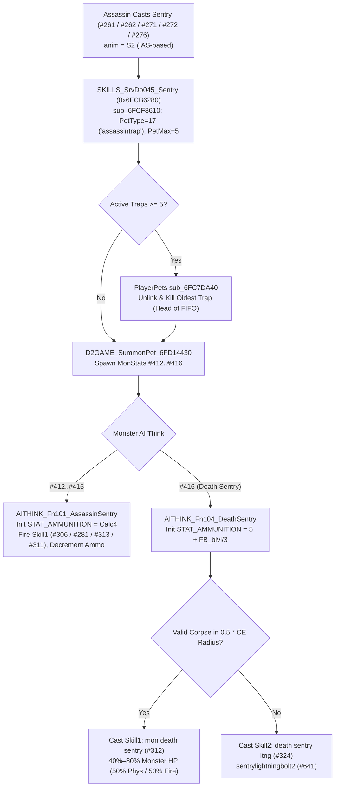

# Diablo II v1.13c Assassin Traps Skill Tree (`Skills.txt` #251, #256, #257, #261, #262, #266, #271, #272, #276, #277) — Server & Client Reverse-Engineering Reference

> **Binary Target**: `D2Game.dll` (`ImageBase = 0x6FC20000`) & `D2Client.dll` (`ImageBase = 0x6FAB0000`), Diablo II: Lord of Destruction v1.13c  
> **Data Tables**: `data/Skills.txt`, `data/Missiles.txt`, `data/MonStats.txt`, `data/States.txt`, `data/PetType.txt` (from 1.13c MPQs in `samples/d2/`)

---

## 1. Executive Summary & Tree Architecture

The Assassin **Traps** tree (`Skills.txt` IDs `#251`, `#256`, `#257`, `#261`, `#262`, `#266`, `#271`, `#272`, `#276`, `#277`) comprises 10 skills organized into three distinct mechanical subsystems in `D2Game.dll` and `D2Client.dll`:

1. **Thrown Lob Traps (`#251` Fire Blast, `#256` Shock Web)**:
   - Direct Assassin projectile skills using the `S2` (Trap Throw) animation sequence (`UseAttackRate = 1` — governed by **IAS**, not FCR).
   - Lob parabolic airborne missiles (`bomb in air` `#385`, `shock field in air` `#388`) via `MISSMODE_SrvHit36_MissileInAir` (`0x6FC5AB30`) and `MissileCltHitFunc[44]` (`0x6FB60740`), spawning ground hazards (`bomb on ground` `#386` radial explosion or `shock field on ground` `#389` persistent `NextDelay = 25` lightning field).
   - Because these missiles are owned directly by the Assassin (`UNIT_PLAYER`), they benefit from item `+% Elemental Skill Damage` and `-% Enemy Resistance` stats.
2. **Summoned Sentry Traps (`#261` Charged Bolt Sentry, `#262` Wake of Fire, `#271` Lightning Sentry, `#272` Wake of Inferno, `#276` Death Sentry)**:
   - All five share a single server handler, `SKILLS_SrvDo045_Sentry` (`0x6FCB6280`), and use `anim = S2` (**trap-laying speed scales exclusively with IAS, never FCR**).
   - Summon stationary `UNIT_MONSTER` pets (`MonStats.txt` `#412`–`#416`) registered under `PetType.txt` `assassintrap` (`idx = 17`, `petmax = 5`).
   - Governed by dedicated monster AI routines (`AITHINK_Fn101_AssassinSentry` for `#412`–`#415` and `AITHINK_Fn104_DeathSentry` for `#416`) that cast monster-specific sub-skills (`#306`, `#281`, `#313`, `#311`, `#312`, `#324`) and track remaining shots in `STAT_AMMUNITION` (`#70`).
   - Because sentries are independent `UNIT_MONSTER` entities, player item `+% Fire/Lightning Skill Damage` and `-% Enemy Fire/Lightning Resistance` (e.g., Rainbow Facets, Griffon's Eye) do **not** apply to sentry trap attacks in 1.13c.
3. **Weapon-Scaling Blade Skills (`#257` Blade Sentinel, `#266` Blade Fury, `#277` Blade Shield)**:
   - Hybrid physical/weapon skills that scale a fraction (`SrcDam / 128`) of the Assassin's equipped weapon damage plus flat skill physical damage.
   - **Blade Sentinel (`#257`)** summons a patrolling `bladecreeper` monster (`#411`, sharing the `assassintrap` `petmax = 5` pool!) locked to a `blade creeper` missile (`#392`, `SrcDam = 48` = `3/8` weapon damage, `Half2HSrc = 1`, `NextDelay = 25`).
   - **Blade Fury (`#266`)** is a channeled `STATE_INFERNO` (`#12`) shuriken stream firing one `bladefury1` (`#505`) every **5 frames** (`5` blades/sec, independent of IAS/FCR), dealing `SrcDam = 96` (`3/4` weapon damage, `Half2HSrc = 1`, `NextDelay = 0`) and applying Crushing Blow, Deadly/Critical Strike, Open Wounds, Life/Mana Leech, Venom, and Chance-to-Cast on Striking without consuming weapon durability.
   - **Blade Shield (`#277`)** is a self-cast `SC` spell (governed by **FCR**) applying `STATE_BLADESHIELD` (`#158`), pulsing `SrcDam = 32` (`1/4` weapon damage, `Half2HSrc = 0`) every `25` frames (`1.0s`) within `4` yards while draining weapon durability on hit.

---

## 2. Master Dispatch Table Reference (v1.13c Virtual Addresses)

### 2.1 Skill Dispatch Tables (`D2Game.dll` & `D2Client.dll`)

| Skill ID | Skill Name (`Skills.txt`) | `SrvStFunc` (`0x6FD27338`) | `SrvDoFunc` (`0x6FD274A8`) | `CltStFunc` (`0x6FB8E928`) | `CltDoFunc` (`0x6FB8EA48`) | Anim / Speed Stat |
| :--- | :--- | :--- | :--- | :--- | :--- | :--- |
| `#251` | **Fire Trauma** (Fire Blast) | `0` (`NULL`) | `0` (Default `lob=1` `#385`) | `0` (`NULL`) | `0` (Default `lob=1` `#385`) | `S2` (**IAS**) |
| `#256` | **Shock Field** (Shock Web) | `0` (`NULL`) | `43` (`0x6FCB4DC0`) | `0` (`NULL`) | `5` (`0x6FAF1890`) | `S2` (**IAS**, `Delay=15`) |
| `#257` | **Blade Sentinel** | `0` (`NULL`) | `44` (`0x6FCB6310`) | `0` (`NULL`) | `0` (`NULL`) | `S2` (**IAS**, `Delay=50`) |
| `#261` | **Charged Bolt Sentry** | `0` (`NULL`) | `45` (`0x6FCB6280`) | `0` (`NULL`) | `0` (`NULL`) | `S2` (**IAS**) |
| `#262` | **Wake Of Fire Sentry** | `0` (`NULL`) | `45` (`0x6FCB6280`) | `0` (`NULL`) | `0` (`NULL`) | `S2` (**IAS**) |
| `#266` | **Blade Fury** | `26` (`0x6FCB5BC0`) | `48` (`0x6FCB5560`) | `8` (`0x6FAF0DE0`) | `6` (`0x6FAF13A0`) | `SQ` (`5f` fixed loop) |
| `#271` | **Lightning Sentry** | `0` (`NULL`) | `45` (`0x6FCB6280`) | `0` (`NULL`) | `0` (`NULL`) | `S2` (**IAS**) |
| `#272` | **Inferno Sentry** (Wake of Inferno) | `0` (`NULL`) | `45` (`0x6FCB6280`) | `0` (`NULL`) | `0` (`NULL`) | `S2` (**IAS**) |
| `#276` | **Death Sentry** | `0` (`NULL`) | `45` (`0x6FCB6280`) | `0` (`NULL`) | `0` (`NULL`) | `S2` (**IAS**) |
| `#277` | **Blade Shield** | `28` (`0x6FCB20C0`) | `54` (`0x6FCB35F0`) | `0` (`NULL`) | `0` (`NULL`) | `SC` (**FCR**) |

#### Summoned Sentry Monster Sub-Skills (`Skills.txt`)

| Skill ID | Sub-Skill Name | Used By Monster (`MonStats.txt`) | `SrvStFunc` | `SrvDoFunc` | `CltStFunc` | `CltDoFunc` |
| :--- | :--- | :--- | :--- | :--- | :--- | :--- |
| `#281` | **Wake Of Destruction Sentry** | `wakeofdestruction` (`#414`) | `0` (`NULL`) | `125` (`0x6FC2D680`) | `0` (`NULL`) | `70` (`0x6FB75A80`) |
| `#306` | **BoltSentry** | `chargeboltsentry` (`#412`) | `0` (`NULL`) | `17` (`0x6FC63B60`) | `0` (`NULL`) | `23` (`0x6FB24AC0`) |
| `#311` | **mon inferno sentry** | `infernosentry` (`#415`) | `53` (`0x6FCD2ED0`) | `95` (`0x6FCD6A60`) | `52` (`0x6FB74370`) | `77` (`0x6FB75BA0`) |
| `#312` | **mon death sentry** | `deathsentry` (`#416`) | `0` (`NULL`) | `55` (`0x6FC6F4D0`) | `50` (`0x6FB74A20`) | `78` (`0x6FB74B00`) |
| `#313` | **sentry lightning** | `lightningsentry` (`#413`) | `0` (`NULL`) | `0` (Default `#526`) | `0` (`NULL`) | `0` (Default `#526`) |
| `#324` | **death sentry ltng** | `deathsentry` (`#416`) | `0` (`NULL`) | `0` (Default `#641`) | `0` (`NULL`) | `0` (Default `#641`) |

### 2.2 Missile Dispatch Tables (`D2Game.dll` & `D2Client.dll`)

| Missile ID | Missile Name (`Missiles.txt`) | `SrvDoFunc` (`0x6FD2D970`) | `SrvHitFunc` (`0x6FD2DA48`) | `CltDoFunc` (`0x6FB8D8A0`) | `CltHitFunc` (`0x6FB8DA10`) | `NextDelay` |
| :--- | :--- | :--- | :--- | :--- | :--- | :--- |
| `#385` | `bomb in air` | `1` (`0x6FC5F540`) | `36` (`0x6FC5AB30`) | `1` (`0x6FB617C0`) | `44` (`0x6FB60740`) | `0` |
| `#386` | `bomb on ground` | `1` (`0x6FC5F540`) | `3` (`0x6FC5BB60`) | `1` (`0x6FB617C0`) | `0` (`NULL`) | `0` |
| `#387` | `bomb explosion` | `1` (`0x6FC5F540`) | `0` (`NULL`) | `1` (`0x6FB617C0`) | `0` (`NULL`) | `0` |
| `#388` | `shock field in air` | `1` (`0x6FC5F540`) | `36` (`0x6FC5AB30`) | `1` (`0x6FB617C0`) | `44` (`0x6FB60740`) | `0` |
| `#389` | `shock field on ground` | `1` (`0x6FC5F540`) | `0` (`NULL`) | `1` (`0x6FB617C0`) | `0` (`NULL`) | **`25`** (`1.0s`) |
| `#392` | `blade creeper` | `20` (`0x6FC60860`) | `37` (`0x6FC58E90`) | `43` (`0x6FB62890`) | `0` (`NULL`) | **`25`** (`1.0s`) |
| `#495` | `sentrychargedbolt` | `1` (`0x6FC5F540`) | `0` (`NULL`) | `1` (`0x6FB617C0`) | `10` (`0x6FB62570`) | `0` |
| `#505` | `bladefury1` | `1` (`0x6FC5F540`) | `52` (`0x6FC5C030`) | `1` (`0x6FB617C0`) | `0` (`NULL`) | `0` |
| `#517` | `wake of destruction maker` | `31` (`0x6FC5F9F0`) | `0` (`NULL`) | `52` (`0x6FB672D0`) | `0` (`NULL`) | **`4`** (`0.16s`) |
| `#518` | `wake of destruction` | `1` (`0x6FC5F540`) | `0` (`NULL`) | `1` (`0x6FB617C0`) | `0` (`NULL`) | **`4`** (`0.16s`) |
| `#519` | `deathsentryexplode` | `1` (`0x6FC5F540`) | `0` (`NULL`) | `1` (`0x6FB617C0`) | `0` (`NULL`) | `0` |
| `#523` | `inferno sentry 1` | `1` (`0x6FC5F540`) | `0` (`NULL`) | `1` (`0x6FB617C0`) | `0` (`NULL`) | `0` |
| `#524` | `inferno sentry 2` | `0` (`NULL`) | `0` (`NULL`) | `1` (`0x6FB617C0`) | `0` (`NULL`) | `0` |
| `#526` | `sentrylightningbolt` | `1` (`0x6FC5F540`) | `0` (`NULL`) | `8` (`0x6FB691C0`) | `0` (`NULL`) | `0` |
| `#552` | `blade shield missile` | `1` (`0x6FC5F540`) | `0` (`NULL`) | `1` (`0x6FB617C0`) | `0` (`NULL`) | `0` |
| `#553` | `blade shield attachment` | `1` (`0x6FC5F540`) | `0` (`NULL`) | `57` (`0x6FB66F60`) | `0` (`NULL`) | `0` |
| `#641` | `sentrylightningbolt2` | `1` (`0x6FC5F540`) | `0` (`NULL`) | `8` (`0x6FB691C0`) | `0` (`NULL`) | `0` |
| `#115` | `corpseexplosion` | `1` (`0x6FC5F540`) | `0` (`NULL`) | `11` (`0x6FB62DC0`) | `0` (`NULL`) | `0` |
| `#99` | `lightninghit` | `0` (`NULL`) | `0` (`NULL`) | `1` (`0x6FB617C0`) | `10` (`0x6FB62570`) | **`4`** (`0.16s`) |

---

## 3. Shared Trap Mechanics & Global Rules

### 3.1 The 5-Trap Global Pet Limit (`PetType.txt` `assassintrap` #17)

Six Traps skills—**Blade Sentinel (`#257`)**, **Charged Bolt Sentry (`#261`)**, **Wake of Fire (`#262`)**, **Lightning Sentry (`#271`)**, **Wake of Inferno (`#272`)**, and **Death Sentry (`#276`)**—summon `UNIT_MONSTER` pets through helper `sub_6FCF8610` (`SkillAss.cpp`):

```c
// D2Game.dll: sub_6FCF8610 (Shared Trap Pet Summon Helper)
D2SummonArgStrc summonArg = {};
summonArg.nPetType = pSkillsTxtRecord->nPetType; // 17 ("assassintrap" in PetType.txt)
summonArg.nHcIdx   = nMonsterId;                 // #411..#416
summonArg.nPetMax  = SKILLS_EvaluateSkillFormula(pUnit, pSkillsTxtRecord->dwPetMax, nSkillId, nSkillLevel); // 5

// Resolve ultimate player owner if cast by a Shadow Warrior / Shadow Master
D2UnitStrc* pOwner = pUnit;
while (pOwner && pOwner->dwUnitType == UNIT_MONSTER) {
    pOwner = AIGENERAL_GetMinionOwner(pOwner);
}
D2UnitStrc* pTrap = D2GAME_SummonPet_6FD14430(pGame, &summonArg);
```

- **FIFO Oldest-Trap Replacement (`PlayerPets.cpp` `sub_6FC7DA40`)**: The player's `assassintrap` pet list (`pPetList->pPetData`) is a singly linked FIFO list. When `nCurrentPets >= nPetMax` (`5`), `sub_6FC7DA40` unlinks the **head** of `pPetData` (the **oldest** active trap) and kills it (`SUNITDMG_KillMonster`) before appending the newly summoned trap at the tail.
- **Blade Sentinel Counts Toward the 5-Trap Cap**: Because `Blade Sentinel` (`#257`) specifies `pettype = assassintrap` (`#17`) and `petmax = 5` in `Skills.txt`, throwing a Blade Sentinel destroys the oldest active sentry trap if 5 traps are already on the field.
- **Shadow Warrior / Master Traps Share the Player's 5-Trap Cap**: Because `sub_6FCF8610` walks `AIGENERAL_GetMinionOwner` until `pOwner->dwUnitType != UNIT_MONSTER`, any sentry trap laid by a Shadow Warrior (`#268`) or Shadow Master (`#279`) is registered into the **Assassin player's** `assassintrap` pet list and displaces the player's own traps!

### 3.2 Trap-Laying Animation Speed: IAS vs. FCR

Every trap-throwing and sentry-laying skill (`#251`, `#256`, `#257`, `#261`, `#262`, `#271`, `#272`, `#276`) uses `anim = S2` (`PLRMODE_SKILL2`) with `UseAttackRate = 1` in `Skills.txt`:
- Trap-laying frame breakpoints are determined by **Increased Attack Speed (`STAT_ITEM_FASTERATTACKRATE`)** and equipped weapon base speed (`WSM`), **never** Faster Cast Rate (`FCR`).
- Only **Blade Shield (`#277`)** uses `anim = SC` (`PLRMODE_CAST`) and scales with **FCR**.
- **Blade Fury (`#266`)** uses `anim = SQ` (`seqnum = 23`), where only the initial wind-up scales with IAS while the channeled firing loop is locked to a hard **5-frame** interval (`PrgCalc1 = 5`).

### 3.3 Why `+Skill Damage%` / `-Enemy Resistance%` Do Not Apply to Sentries

When `SKILLS_SrvDo045_Sentry` (`0x6FCB6280`) spawns a sentry (`#412`–`#416`), `D2GAME_SetSummonPassiveStats_6FD0C530` copies only the skill's `sumskill1..5` levels (`Skills.txt` synergy skill levels) and `sumustat` onto the newly created `UNIT_MONSTER`. When the sentry fires its sub-skill (`#306`, `#281`, `#313`, `#311`, `#312`, `#324`), the damage source unit (`pAttacker`) is the **sentry monster**, not the Assassin player:
- `STAT_PASSIVE_FIRE_MASTERY` (`#329`), `STAT_PASSIVE_LTNG_MASTERY` (`#330`), `STAT_PASSIVE_FIRE_PIERCE` (`#333`), and `STAT_PASSIVE_LTNG_PIERCE` (`#334`) on the Assassin's equipment are **not** inherited by the sentry monster.
- By contrast, **Fire Blast (`#251`)** and **Shock Web (`#256`)** spawn missiles whose `pOwner` is the Assassin (`UNIT_PLAYER`), so all player mastery and pierce stats apply normally.

---

## 4. Thrown Lob Traps (`#251` Fire Blast, `#256` Shock Web)

### 4.1 Fire Blast (`Skills.txt` #251 — `Fire Trauma`)

| Property | Value (`Skills.txt` / `Missiles.txt`) |
| :--- | :--- |
| **Required Level / Prereqs** | `reqlevel = 1`, None |
| **Animation / Speed** | `anim = S2`, `UseAttackRate = 1` (**IAS**), `Delay = 0` |
| **Mana Cost** | `minmana = 1`, `manashift = 5`, `mana = 24`, `lvlmana = 1` $\rightarrow$ $\lfloor (24 + (\text{slvl}-1)) \times 2^5 \rfloor / 256 = \mathbf{3 + 0.125 \times (\text{slvl}-1)}$ |
| **Server / Client Handler** | `SrvDoFunc = 0`, `CltDoFunc = 0`, `lob = 1`, `srvmissile = bomb in air` (`#385`) |
| **Missile Chain** | `bomb in air` (`#385`, `Vel=12, Range=50`) $\rightarrow$ `bomb on ground` (`#386`, `Range=5`) $\rightarrow$ `bomb explosion` (`#387`) |
| **Explosion Radius** | `aurarng = par1 = 5` sub-tiles ($\mathbf{3.33\text{ yards}}$) |
| **Fire Damage (`HitShift = 7`)** | Base (`6`–`8`), `+lvl`: `(3..5)` slvl 2–8, `(8..11)` slvl 9–16, `(20..24)` slvl 17–22, `(38..44)` slvl 23–28, `(58..66)` slvl 29+ (all $\times 2^7 / 256 = \mathbf{\times 0.5}$) |
| **Synergies (`Param8 = 9`)** | **`+9%` Fire Damage per base level** in: Shock Web (`#256`), Charged Bolt Sentry (`#261`), Wake of Fire (`#262`), Lightning Sentry (`#271`), Wake of Inferno (`#272`), Death Sentry (`#276`) |

#### Server & Client Execution (`lob = 1` -> `MISSMODE_SrvHit36` -> `MISSMODE_SrvHit03`)

1. **Lob Launch (`D2GAME_SKILLS_Handler` -> `sub_6FD11710`)**: Because `SrvDoFunc = 0` and `lob = 1`, the generic skill dispatcher lobs `bomb in air` (`#385`) along a parabolic arc toward `(nTargetX, nTargetY)` (`cHitag = 1`).
2. **Air-to-Ground Transition (`MISSMODE_SrvHit36_MissileInAir` @ `0x6FC5AB30` / `CltHitFunc[44]` @ `0x6FB60740`)**: When `bomb in air` lands (`Range` expires or ground impact), `SrvHit36` spawns `pMissilesTxtRecord->wHitSubMissile[0]` = `bomb on ground` (`#386`, `Range = 5` frames). On the client, `0x6FB60740` spawns `#386` and transfers lighting/sound state.
3. **Radial Detonation (`MISSMODE_SrvHit03_ExplosivePotion_BombOnGround` @ `0x6FC5BB60`)**: When `bomb on ground` (`#386`) finishes its 5-frame fuse, `SrvHit03` evaluates `AuraRangeCalc` (`Param1 = 5` sub-tiles), constructs a fire `D2DamageStrc` from `Skills.txt` `#251`, calls `sub_6FC627B0` to damage all enemies within radius `5`, and spawns visual sub-missile `bomb explosion` (`#387`).

---

### 4.2 Shock Web (`Skills.txt` #256 — `Shock Field`)

| Property | Value (`Skills.txt` / `Missiles.txt`) |
| :--- | :--- |
| **Required Level / Prereqs** | `reqlevel = 6`, Fire Blast (`#251`) |
| **Animation / Casting Delay** | `anim = S2` (**IAS**), **`Delay = 15` frames (`0.6s`)** |
| **Mana Cost** | `minmana = 1`, `manashift = 8`, `mana = 6`, `lvlmana = 0` $\rightarrow$ **`6` mana flat** |
| **Spike Count (`PrgCalc1`)** | `par1 + lvl/par2 + skill('Fire Trauma'.blvl)/par3` = **`6 + \lfloor \text{slvl}/4 \rfloor + \lfloor \text{FireBlast\_blvl}/3 \rfloor` spikes** |
| **Scatter Radius (`aurarng`)** | `(clc1 / 4) + 1` = **`\lfloor \text{SpikeCount}/4 \rfloor + 1` sub-tiles** |
| **Ground Duration / `NextDelay`** | `shock field on ground` (`#389`): `Range = 90` frames (**`3.6s`**), `Size = 2`, **`NextDelay = 25` frames (`1.0s`)** |
| **Lightning Damage (`HitShift = 7`)** | `EMin = 2` (`+0/lvl` $\rightarrow$ **`1` min dmg**); `EMax = 20` (`+6` slvl 2–8, `+12` slvl 9–16, `+20` slvl 17–22, `+30` slvl 23–28, `+42` slvl 29+) $\times 0.5$ |
| **Synergies (`Param8 = 11`)** | **`+11%` Lightning Damage per base level** in: Charged Bolt Sentry (`#261`), Lightning Sentry (`#271`), Death Sentry (`#276`) |

#### Server Implementation (`SKILLS_SrvDo043_ShockField` @ `0x6FCB4DC0`)

```c
// D2Game.dll: 0x6FCB4DC0 (SKILLS_SrvDo043_ShockField)
int32_t nCount  = SKILLS_EvaluateSkillFormula(pUnit, pSkillsTxtRecord->dwPrgCalc[0], nSkillId, nSkillLevel); // 6 + slvl/4 + FB_blvl/3
int32_t nRadius = SKILLS_EvaluateSkillFormula(pUnit, pSkillsTxtRecord->dwAuraRangeCalc, nSkillId, nSkillLevel); // nCount/4 + 1
// Calls sub_6FCF8330 to lob nCount instances of wSrvMissileA (#388 "shock field in air")
// randomly distributed in [-nRadius, +nRadius] around (nTargetX, nTargetY).
return sub_6FCF8330(pGame, pUnit, nSkillId, nSkillLevel, pSkillsTxtRecord->wSrvMissileA, nRadius, nCount);
```

- **Landing & `NextDelay = 25` Interaction**: Each `shock field in air` (`#388`) triggers `MISSMODE_SrvHit36_MissileInAir` (`0x6FC5AB30`) on landing, spawning a `shock field on ground` (`#389`) missile (`Range = 90` frames, `CollideType = 3`, `LastCollide = 0`, `NextHit = 1`, `NextDelay = 25`). Because all spikes share `NextDelay = 25` frames (`1.0s`), overlapping spikes cannot damage the same target more than once per second—and while active, they lock out any other missile with `NextHit = 1` for 25 frames!
- **Client Implementation (`SkillCltDoFunc[5]` @ `0x6FAF1890`)**: Evaluates `PrgCalc1` (`+0x154`) and `AuraRangeCalc` (`+0xB4`) and calls `0x6FB527B0` to lob `wCltMissileA` (`#388`) across the identical random scatter box using the skill's `SEED_InitLowSeed`.

---

## 5. Summoned Sentry Traps (`#261`, `#262`, `#271`, `#272`, `#276`)

All five stationary sentry skills execute `SKILLS_SrvDo045_Sentry` (`0x6FCB6280`), which maps the skill ID to a `MonStats.txt` index (`#412`–`#416`), calls `sub_6FCF8610` to summon the sentry into the `assassintrap` (`#17`, `petmax = 5`) pool, sets `MONSTER_SetAiState(pMon, 1)`, and relies on the sentry's `MonStats.txt` AI function to fire its sub-skill until its ammunition count (`STAT_AMMUNITION` `#70`) reaches zero.



### 5.1 Sentry AI & Ammunition Lifecycle (`AiThink.cpp`)

#### `AITHINK_Fn101_AssassinSentry` (`#412` CBS, `#414` WoF, `#413` LS, `#415` WoI)
1. **Initialization (`bAiParam[0] == 0`)**: Sets `bAiParam[0] = 1`, evaluates `Calc4` on the sentry's `Skill1` (`Skills.txt` `#306`, `#281`, `#313`, or `#311`), and stores the total shot count into `STAT_AMMUNITION` (`#70`). If `STAT_AMMUNITION <= 0`, kills the sentry (`SUNITDMG_KillMonster`).
2. **Firing Loop (`bAiParam[0] == 1`)**: Searches for the nearest valid enemy within `AiParam1` (`15` sub-tiles for CBS/WoF, `20` sub-tiles for LS/WoI) with line-of-sight. When found, decrements `STAT_AMMUNITION` by `1` and orders `D2GAME_EVENTS_UseSkill` (`Skill1`). Once `STAT_AMMUNITION` reaches `0` after firing, transitions to `bAiParam[0] = 2` and self-destructs (`SUNITDMG_KillMonster`) on the next AI tick.

---

### 5.2 Charged Bolt Sentry (`Skills.txt` #261 -> `MonStats` #412 -> `BoltSentry` #306)

| Property | Value (`Skills.txt` #261 & #306 / `Missiles.txt` #495) |
| :--- | :--- |
| **Required Level / Prereqs** | `reqlevel = 12`, Shock Web (`#256`) |
| **Mana Cost / Anim** | **`13` mana flat** (`min=1, shift=8, base=13, +lvl=0`), `anim = S2` (**IAS**) |
| **Sentry Monster (`#412`)** | `chargeboltsentry`, AI = `AssassinSentry` (`Fn101`), `AiParam1 = 15` sub-tiles (`10` yards) |
| **Shot Count (`#306` `Calc4`)** | `par8 + skill('Lightning Sentry'.blvl)/par7` = **`5 + \lfloor \text{LS\_blvl}/4 \rfloor` shots** |
| **Bolts per Shot (`#306` `Calc1`)** | `par1 + skill('Shock Field'.blvl)/par2` = **`5 + \lfloor \text{ShockWeb\_blvl}/3 \rfloor` bolts** |
| **Missile (`#495`)** | `sentrychargedbolt` (`Vel = 10`, `Range = 80` frames, `Size = 1`, `NextDelay = 0`) |
| **Lightning Damage (`HitShift = 7`)** | `EMin = 2` (`1` min dmg); `EMax = 14` (`+6` slvl 2–8, `+8` slvl 9–16, `+12` slvl 17–22, `+14` slvl 23–28, `+16` slvl 29+) $\times 0.5$ |
| **Synergies (`Param5 = 6`)** | **`+6%` Lightning Damage per base level** in: Fire Blast (`#251`), Lightning Sentry (`#271`), Death Sentry (`#276`) |

- **Server & Client Execution**: `BoltSentry` (`#306`) dispatches to `SKILLS_SrvDo017_ChargedBolt_BoltSentry` (`0x6FC63B60`) on the server and `SkillCltDoFunc[23]` (`0x6FB24AC0`) on the client. Both evaluate `Calc1` (`5 + ShockWeb_blvl/3`) and fire a fan of `sentrychargedbolt` (`#495`) missiles along randomized jittered angles toward the target.

---

### 5.3 Wake of Fire (`Skills.txt` #262 -> `MonStats` #414 -> `Wake Of Destruction Sentry` #281)

| Property | Value (`Skills.txt` #262 & #281 / `Missiles.txt` #517 & #518) |
| :--- | :--- |
| **Required Level / Prereqs** | `reqlevel = 12`, Fire Blast (`#251`) |
| **Mana Cost / Anim** | **`13` mana flat** (`min=1, shift=8, base=13, +lvl=0`), `anim = S2` (**IAS**) |
| **Sentry Monster (`#414`)** | `wakeofdestruction`, AI = `AssassinSentry` (`Fn101`), `AiParam1 = 15` sub-tiles (`10` yards) |
| **Shot Count (`#281` `Calc4`)** | `par8 = 5` $\rightarrow$ **`5` shots** |
| **Missile Chain** | `wake of destruction maker` (`#517`, `Vel=10, Range=25`) $\rightarrow$ perpendicular pairs of `wake of destruction` (`#518`, `Vel=8, Range=20`) |
| **`NextDelay`** | **`NextDelay = 4` frames (`0.16s`)** on both `#517` and `#518` (`NextHit = 1`, `LastCollide = 0`) |
| **Fire Damage (`HitShift = 8`)** | `EMin = 5` (`+2,+3,+5,+7,+9`), `EMax = 10` (`+2,+3,+6,+8,+10`), `HitShift = 8` (`1.0x`) |
| **Synergies (`Param7 = 8`)** | **`+8%` Fire Damage per base level** in: Fire Blast (`#251`), Wake of Inferno (`#272`) |

#### V-Wave Geometry (`SKILLS_SrvDo125` @ `0x6FC2D680` & `MISSMODE_SrvDo31` @ `0x6FC5F9F0`)

1. **Invisible Carrier Launch (`SKILLS_SrvDo125_WakeOfDestruction` @ `0x6FC2D680` / `CltDoFunc[70]` @ `0x6FB75A80`)**:
   Computes the vector $(\Delta x, \Delta y) = (\text{TargetX} - X, \text{TargetY} - Y)$, spawns `wake of destruction maker` (`#517`) traveling along $(\Delta x, \Delta y)$, and stores the **perpendicular vector** $(-\Delta y, \Delta x)$ into the carrier missile's `InitSteps` (`dwParam1`) and `InitDrift` (`dwParam2`):
   ```c
   // D2Game.dll: 0x6FC2D680 (SKILLS_SrvDo125_WakeOfDestruction)
   int32_t nDiffX = nTargetX - nX;
   int32_t nDiffY = nTargetY - nY;
   D2UnitStrc* pMaker = sub_6FD11420(pGame, pSkillsTxtRecord->wSrvMissileA, pUnit, nSkillId, nSkillLevel, 0, 0, nTargetX, nTargetY, 1);
   if (pMaker) {
       MISSILE_SetInitSteps(pMaker, -nDiffY); // Perpendicular X = -dy
       MISSILE_SetInitDrift(pMaker,  nDiffX); // Perpendicular Y = +dx
   }
   ```
2. **Perpendicular Wing Spawning (`MISSMODE_SrvDo31_WakeOfDestructionMaker_BaalColdMaker` @ `0x6FC5F9F0` / `MissileCltDoFunc[52]` @ `0x6FB672D0`)**:
   Every frame as `wake of destruction maker` (`#517`) advances toward the target, `SrvDo31` (and client `0x6FB672D0`) reads the stored perpendicular vector $(P_x, P_y) = (-\Delta y, \Delta x)$ and spawns **two** `wake of destruction` (`#518`) sub-missiles from the carrier's current position: one aimed toward $(X + P_x, Y + P_y)$ and one aimed toward $(X - P_x, Y - P_y)$. The forward motion of `#517` combined with the outward lateral motion of `#518` produces the expanding V-shaped fire wave!

---

### 5.4 Lightning Sentry (`Skills.txt` #271 -> `MonStats` #413 -> `sentry lightning` #313)

| Property | Value (`Skills.txt` #271 & #313 / `Missiles.txt` #526) |
| :--- | :--- |
| **Required Level / Prereqs** | `reqlevel = 24`, Charged Bolt Sentry (`#261`) |
| **Mana Cost / Anim** | **`20` mana flat** (`min=1, shift=8, base=20, +lvl=0`), `anim = S2` (**IAS**) |
| **Sentry Monster (`#413`)** | `lightningsentry`, AI = `AssassinSentry` (`Fn101`), `AiParam1 = 20` sub-tiles (`13.33` yards) |
| **Shot Count (`#313` `Calc4`)** | `par8 = 10` $\rightarrow$ **`10` shots** |
| **Missile (`#526`)** | `sentrylightningbolt` (`Vel = 30`, `Range = 10` frames = `20` yards, `Size = 2`, `LastCollide = 1`, **`NextDelay = 0`**) |
| **Lightning Damage (`HitShift = 8`)** | `EMin = 1` (`+0/lvl`), `EMax = 20` (`+10` slvl 2–8, `+16` slvl 9–16, `+24` slvl 17–22, `+34` slvl 23–28, `+44` slvl 29+) |
| **Synergies (`Param7 = 12`)** | **`+12%` Lightning Damage per base level** in: Shock Web (`#256`), Charged Bolt Sentry (`#261`), Death Sentry (`#276`) |

- **Server & Client Execution**: `sentry lightning` (`#313`) uses `SrvDoFunc = 0` / `CltDoFunc = 0` to fire `sentrylightningbolt` (`#526`). On the server, `#526` has `LastCollide = 1` and `NextDelay = 0`, piercing through enemies in a straight line and applying full lightning damage without triggering `NextDelay` lockouts on the primary bolt. On the client, `MissileCltDoFunc[8]` (`0x6FB691C0`) spawns trailing `lightninghit` (`#99`) visual segments behind the head bolt once `nFrame >= Activate` (`1`).

---

### 5.5 Wake of Inferno (`Skills.txt` #272 -> `MonStats` #415 -> `mon inferno sentry` #311)

| Property | Value (`Skills.txt` #272 & #311 / `Missiles.txt` #523) |
| :--- | :--- |
| **Required Level / Prereqs** | `reqlevel = 24`, Wake of Fire (`#262`) |
| **Mana Cost / Anim** | **`20` mana flat** (`min=1, shift=8, base=20, +lvl=0`), `anim = S2` (**IAS**) |
| **Sentry Monster (`#415`)** | `infernosentry`, AI = `AssassinSentry` (`Fn101`), `AiParam1 = 20` sub-tiles (`13.33` yards) |
| **Shot Count (`#311` `Calc4`)** | `par8 = 10` $\rightarrow$ **`10` channeled bursts** |
| **Flame Range (`#311` `Calc1`)** | `(par1 + skill('Wake Of Fire Sentry'.blvl))*2` = **`(10 + \text{WoF\_blvl}) \times 2` sub-tiles** (divided by `Vel/2` for missile `Range`) |
| **Channel Duration (`#311` `Calc2`)** | `par3 + skill('Wake Of Fire Sentry'.blvl)` = **`15 + \text{WoF\_blvl}` frames per shot** |
| **Fire Damage (`HitShift = 4`)** | `EMin = 20` (`+17,+21,+26,+32,+39`), `EMax = 50` (`+19,+23,+28,+34,+41`) $\times 2^4 / 256 = \mathbf{\times 1/16\text{ per frame}}$ |
| **Synergies** | **`+10%` Fire Damage/blvl** in Fire Blast (`#251`) & Death Sentry (`#276`); **`+7%` Fire Damage/blvl** in Wake of Fire (`#262`) |

- **Server & Client Channeled Burst (`SKILLS_SrvSt53_MonInferno` @ `0x6FCD2ED0` & `SKILLS_SrvDo095_MonInferno` @ `0x6FCD6A60`)**:
  - `SrvSt53` (and client `SkillCltStFunc[52]` @ `0x6FB74370`) evaluates `Calc2` (`15 + WoF_blvl` frames), stores `nEndFrame = dwCurrentFrame + Calc2` into `SkillParam1`, and applies `STATE_INFERNO` (`#12`).
  - Each frame while `dwCurrentFrame < SkillParam1`, `SrvDo095` (and client `SkillCltDoFunc[77]` @ `0x6FB75BA0`) spawns `inferno sentry 1` (`#523`, `Size = 1` narrow hitbox) with custom range `2 * Calc1 / Vel` and rewinds the monster's sequence frame so it continuously sprays fire for `15 + WoF_blvl` frames per ammunition point.

---

### 5.6 Death Sentry (`Skills.txt` #276 -> `MonStats` #416 -> `#312` & `#324`)

| Property | Value (`Skills.txt` #276, #312, #324 / `Missiles.txt` #641, #115, #519) |
| :--- | :--- |
| **Required Level / Prereqs** | `reqlevel = 30`, Lightning Sentry (`#271`) |
| **Mana Cost / Anim** | **`20` mana flat** (`min=1, shift=8, base=20, +lvl=0`), `anim = S2` (**IAS**) |
| **Sentry Monster (`#416`)** | `deathsentry`, AI = `DeathSentry` (`AITHINK_Fn104_DeathSentry`), `AiParam1 = 20` |
| **Shot Count (`#312` `Calc4`)** | `par8 + skill('Fire Trauma'.blvl)/3` = **`5 + \lfloor \text{FireBlast\_blvl}/3 \rfloor` shots** (up to **11 shots** at FB blvl 18+) |
| **Mode 1: Corpse Explosion (`#312`)** | `SKILLS_SrvDo055_CorpseExplosion` (`0x6FC6F4D0`): **`40%`–`80%` of monster base HP** (`Calc1=40, Calc2=80`), **`50%` Physical + `50%` Fire** (`Calc3=50`), radius = `10 + (slvl-1)` sub-tiles ($\mathbf{3.33 + 0.33 \times (\text{slvl}-1)\text{ yards}}$) |
| **Mode 2: Lightning Bolt (`#324`)** | `sentrylightningbolt2` (`#641`, `Vel=30, Range=10`): `EMin = 1`, `EMax = 50` (`+8,+14,+22,+28,+34`), `HitShift = 8`, **`+12%` Lightning Damage per blvl in Lightning Sentry (`#271`)** |

#### Dual-Mode AI Decision Logic (`AITHINK_Fn104_DeathSentry` in `AiThink.cpp`)

1. **Ammunition Init**: On its first tick (`bAiParam[0] == 0`), `AITHINK_Fn104_DeathSentry` evaluates `Calc4` on `Skill1` (`mon death sentry` `#312`): `5 + FireBlast_blvl / 3` shots (every 3 base points in Fire Blast grants `+1` shot to Death Sentry!) and writes it to `STAT_AMMUNITION` (`#70`).
2. **Corpse Acquisition vs. Lightning Fallback**:
   - On each active tick, `Fn104` evaluates the Corpse Explosion radius (`AuraRangeCalc` of `#312` = `10 + (slvl-1)` sub-tiles) and searches for a valid, unexploded monster corpse (`STATES_CheckStateMaskStayDeathOnUnit == 0`) within **`0.5 * AuraRangeCalc`** (`sub_6FD15210` with `nMaxDist = nRadius / 2`).
   - **If a corpse is found within half-radius**: Decrements `STAT_AMMUNITION` and casts `mon death sentry` (`#312`) on the corpse. `SKILLS_SrvDo055_CorpseExplosion` (`0x6FC6F4D0`) consumes the corpse (`STATE_CORPSE_NOSELECT`), rolls random base monster HP between `Calc1` (`40%`) and `Calc2` (`80%`), splits it `50%` Physical + `50%` Fire (`Calc3 = 50`), and deals radial damage across the full `AuraRangeCalc` (`10 + slvl - 1` sub-tiles). On the client, `SkillCltStFunc[50]` (`0x6FB74A20`) records the corpse `(X, Y)` into `SkillParam1/2`, and `SkillCltDoFunc[78]` (`0x6FB74B00`) spawns `corpseexplosion` (`#115` -> `MissileCltDoFunc[11]` @ `0x6FB62DC0` + `bigblood1/2` `#20/#21` gore chunks via `MissileCltDoFunc[2]` @ `0x6FB63060`) plus `deathsentryexplode` (`#519`).
   - **If no corpse is in range**: Searches for a living enemy within `AiParam1` (`20` sub-tiles), decrements `STAT_AMMUNITION`, and casts `death sentry ltng` (`#324`), firing `sentrylightningbolt2` (`#641`).

---

## 6. Weapon-Scaling Blade Skills (`#257` Blade Sentinel, `#266` Blade Fury, `#277` Blade Shield)

### 6.1 Weapon Damage & `Half2HSrc` Comparison Matrix

| Skill | `SrcDam` (`/128`) | `Half2HSrc` (`Missiles.txt`) | Effective 1H Weapon Mult | Effective 2H Weapon Mult | Attack Rate / Interval | `NextDelay` | Uses Weapon Durability? |
| :--- | :--- | :--- | :--- | :--- | :--- | :--- | :--- |
| **Blade Sentinel (`#257`)** | `48` | **`1`** (on `#392`) | **`3/8` (`37.5%`)** | **`3/16` (`18.75%`)** | Patrols back & forth (`Vel=10`) | **`25` frames (`1.0s`)** | **No** (missile hit) |
| **Blade Fury (`#266`)** | `96` | **`1`** (on `#505`) | **`3/4` (`75.0%`)** | **`3/8` (`37.5%`)** | **Fixed `5` frames/blade** | `0` | **No** (missile hit) |
| **Blade Shield (`#277`)** | `32` | **`0`** (aura pulse) | **`1/4` (`25.0%`)** | **`1/4` (`25.0%`)** | **Fixed `25` frames (`1.0s`)** | N/A (periodic aura) | **Yes** (`sub_6FCF9490`) |

> **Why Two-Handed Weapons Are Penalized on Blade Sentinel & Blade Fury**: When `SUNITDMG_FillDamageValues` calculates missile weapon scaling (`SrcDam`), if `pMissilesTxtRecord->dwBitfields & MISSILESFLAG_HALF2HSRC` (`Half2HSrc = 1` in `Missiles.txt` for `#392` `blade creeper` and `#505` `bladefury1`) and the caster's active weapon is two-handed (`ITEMS_CheckWeaponIfTwoHanded(pWeapon) != 0`), `SrcDam` is **halved** (`nSrcDam >>= 1`)! Thus Blade Fury drops from `3/4` (`75%`) to `3/8` (`37.5%`) weapon damage when wielding a two-handed weapon, whereas Blade Shield's periodic aura pulse does not go through a `Half2HSrc` missile and retains its full `1/4` (`25%`) weapon damage with two-handed weapons.

---

### 6.2 Blade Sentinel (`Skills.txt` #257)

| Property | Value (`Skills.txt` #257 / `Missiles.txt` #392) |
| :--- | :--- |
| **Required Level / Prereqs** | `reqlevel = 6`, None |
| **Animation / Casting Delay** | `anim = S2` (**IAS**), **`Delay = 50` frames (`2.0s`)** |
| **Mana Cost** | **`7` mana flat** (`min=1, shift=8, base=7, +lvl=0`) |
| **Summoned Pet (`#411`)** | `bladecreeper`, `PetType = 17` (`assassintrap`, **`petmax = 5`**), AI = `BladeCreeper` (`AITHINK_Fn102`) |
| **Patrol Duration (`Calc4`)** | `ln12` = `par1 + (lvl-1)*par2` = **`100 + 12 \times (\text{slvl}-1)` frames (`4.0 + 0.48 \times (\text{slvl}-1)`s)** |
| **Physical Damage (`HitShift = 8`)** | **`3/8` 1H (`3/16` 2H) Weapon Damage** + Flat Physical: Base (`6`–`10`), `+lvl`: `+3` (slvl 2–8), `+4` (slvl 9–16), `+5` (slvl 17+) |
| **Collision / `NextDelay`** | `blade creeper` (`#392`): `NextHit = 1`, **`NextDelay = 25` frames (`1.0s`)** |

#### Monster-Missile Lockstep Architecture (`SKILLS_SrvDo044` -> `AITHINK_Fn102` -> `MISSMODE_SrvDo20`)

1. **Monster Summon & Waypoint Command (`SKILLS_SrvDo044_BladeSentinel` @ `0x6FCB6310`)**:
   Summons invisible helper monster `bladecreeper` (`#411`) via `sub_6FCF8610` (`PetType = 17`, counting toward the 5-trap cap!) at the caster's position and pushes an AI command storing the caster's origin `(nX, nY)` in `nCmdParam[1..2]` and the target point `(nTargetX, nTargetY)` in `nCmdParam[3..4]`.
2. **Patrol AI & Missile Spawn (`AITHINK_Fn102_BladeCreeper` in `AiThink.cpp`)**:
   On its first AI tick (`bAiParam[0] == 0`), `Fn102` sets patrol expiration frame `dwParam[2] = dwCurrentFrame + Calc4` (`100 + 12*(slvl-1)`) and spawns the visible `blade creeper` missile (`#392`), storing the `bladecreeper` monster's `dwUnitId` in the missile's `InitSteps` (`MISSILE_SetInitSteps`). On subsequent ticks, `Fn102` walks the monster back and forth between `(nCmdParam[1], nCmdParam[2])` and `(nCmdParam[3], nCmdParam[4])` until `dwCurrentFrame >= dwParam[2]`, then kills the monster.
3. **Frame-by-Frame Position Lock (`MISSMODE_SrvDo20_BladeCreeper` @ `0x6FC60860` / `MissileCltDoFunc[43]` @ `0x6FB62890` / `MISSMODE_SrvHit37` @ `0x6FC58E90`)**:
   Every frame, `SrvDo20` (and client `0x6FB62890`) looks up the `bladecreeper` monster by `MISSILE_GetInitSteps(pMissile)` and teleports the `blade creeper` missile (`#392`) to the monster's exact coordinates (`DUNGEON_ToggleDrlgCoords`). Whenever the missile collides with an enemy, `MISSMODE_SrvHit37_BladeCreeper` (`0x6FC58E90`) applies `SrcDam = 48` (`Half2HSrc = 1`) + flat skill physical damage (`NextDelay = 25` frames).

---

### 6.3 Blade Fury (`Skills.txt` #266)

| Property | Value (`Skills.txt` #266 / `Missiles.txt` #505) |
| :--- | :--- |
| **Required Level / Prereqs** | `reqlevel = 18`, Blade Sentinel (`#257`), Wake of Fire (`#262`) |
| **Animation / Channel Loop** | `anim = SQ` (`seqnum = 23`, `seqinput = 12`), `UseManaOnDo = 1`, **Fixed `5` frames per blade (`PrgCalc1 = Param4 = 5`)** |
| **Mana Cost (per blade)** | `minmana = 0`, `manashift = 5`, `mana = 8`, `lvlmana = 1` $\rightarrow$ **`1.0 + 0.125 \times (\text{slvl}-1)` mana per blade** |
| **Physical Damage (`HitShift = 8`)** | **`3/4` 1H (`3/8` 2H) Weapon Damage** + Flat Physical: Base (`8`–`10`), `+lvl`: `+3` (slvl 2–8), `+5` (slvl 9–16), `+8` (slvl 17+) |
| **Missile (`#505`)** | `bladefury1` (`Vel = 18`, `Range = 22` frames, `Size = 2`, `SrcDam = 96`, `Half2HSrc = 1`, `HitFlags = 2`, `NextDelay = 0`) |
| **On-Hit Modifiers** | Applies Attack Rating (`ToHit = 10 + 7*(slvl-1)%`? Note: AR bonus in `Skills.txt` is `ToHit=10, LevToHit=7`, though 1.13c missile AR bug ignores skill% AR), Crushing Blow, Deadly/Critical Strike, Open Wounds, Life/Mana Leech, Elemental/Venom damage, and CtC on Striking; **does NOT consume weapon durability** |

#### Server & Client Channeled Firing Loop (`SrvSt26` / `SrvDo048` & `CltSt8` / `CltDo6`)

1. **Wind-Up Start (`SKILLS_SrvSt26_BladeFury` @ `0x6FCB5BC0` / `SkillCltStFunc[8]` @ `0x6FAF0DE0`)**:
   Evaluates startup delay `Calc1 = ul(par1, par2 - (lvl-1)/par3)` = `max(2, 6 - (slvl-1)/5)` frames (`6` frames at slvl 1–5, down to `2` frames at slvl 21+), stores it into `SkillParam1`, and activates `STATE_INFERNO` (`#12`) on the Assassin.
2. **5-Frame Firing Loop (`SKILLS_SrvDo048_BladeFury` @ `0x6FCB5560` / `SkillCltDoFunc[6]` @ `0x6FAF13A0`)**:
   Each frame while the skill button is held and `STATE_INFERNO` (`#12`) is active:
   - Decrements `SkillParam1`. When `SkillParam1 <= 0`, checks and deducts mana (`UseManaOnDo = 1`), resets `SkillParam1 = PrgCalc1` (**`5` frames**), and spawns `bladefury1` (`#505`) toward `(nTargetX, nTargetY)`.
   - Rewinds the Assassin's animation frame (`UNITS_SetAnimationFrame(pUnit, 8)` / client `[ebx+0x48] = 0x800`) to hold the channeled throwing loop.
3. **Impact & Shrapnel (`MISSMODE_SrvHit52_BladeFury` @ `0x6FC5C030`)**:
   When `bladefury1` (`#505`) hits a target or obstacle, `SrvHit52` performs a physical attack roll (`ToHit = 1` in `Missiles.txt`) applying `3/4` (1H) or `3/8` (2H) weapon damage plus flat skill physical damage, and spawns visual shatter sub-missile `bladefragment1` (`#506`).

---

### 6.4 Blade Shield (`Skills.txt` #277)

| Property | Value (`Skills.txt` #277 / `Missiles.txt` #552 & #553) |
| :--- | :--- |
| **Required Level / Prereqs** | `reqlevel = 30`, Blade Fury (`#266`) |
| **Animation / Speed** | `anim = SC` (**uses FCR**), `aurastate = bladeshield` (`STATE_BLADESHIELD` `#158`) |
| **Mana Cost** | `minmana = 1`, `manashift = 8`, `mana = 27`, `lvlmana = 2` $\rightarrow$ **`27 + 2 \times (\text{slvl}-1)` mana** |
| **Duration (`AuraLenCalc`)** | `ln12` = `par1 + (lvl-1)*par2` = **`500 + 125 \times (\text{slvl}-1)` frames (`20 + 5 \times (\text{slvl}-1)` seconds)** |
| **Pulse Period / Radius** | **`perdelay = Param3 = 25` frames (`1.0s`)**, **`aurarng = Param4 = 6` sub-tiles (`4.0` yards)** |
| **Physical Damage (`HitShift = 8`)** | **`1/4` (`32/128`) Weapon Damage (`Half2HSrc = 0`, 2H NOT halved!)** + Flat Physical: Base (`1`–`30`), `+lvl`: `+5` (slvl 2–8), `+6` (slvl 9–16), `+7` (slvl 17+) |
| **On-Hit Properties** | Uses standard melee hit check (`sub_6FCF9490`), applies Leech, Elemental/Venom damage, Deadly/Critical Strike, and CtC on Striking, **and drains weapon durability on hit** (does NOT apply Crushing Blow or Open Wounds in 1.13c) |

#### Server Periodic Aura & Client Orbiting Blades (`SrvSt28` / `SrvDo054` & `MissileCltDoFunc[57]`)

1. **Buff Application & Periodic Callback (`SKILLS_SrvSt28_BladeShield` @ `0x6FCB20C0` & `SKILLS_SrvDo054_BladeShield` @ `0x6FCB35F0`)**:
   - On cast, `SrvSt28` and `SrvDo054` apply `STATE_BLADESHIELD` (`#158`) for `500 + 125*(slvl-1)` frames and register a periodic state timer (`perdelay = 25` frames).
   - Every `25` frames (`1.0s`) while `STATE_BLADESHIELD` is active, the state's periodic callback invokes `SKILLS_SrvDo054_BladeShield` (`0x6FCB35F0`) with `pSkillsTxtRecord->nAuraRangeCalc` (`6` sub-tiles), which calls `sub_6FCF9490` on every enemy within `6` sub-tiles (`4` yards) to roll an attack rating check and deal `32/128` (`25%`) weapon damage + flat skill physical damage.
2. **Client Visual Orbit (`States.txt` #158 -> `blade shield attachment` #553 -> `MissileCltDoFunc[57]` @ `0x6FB66F60`)**:
   - `States.txt` `#158` (`bladeshield`) specifies `missile = blade shield attachment` (`#553`, `CltDoFunc = 57`).
   - `MissileCltDoFunc[57]` (`0x6FB66F60`) anchors `#553` to the Assassin's coordinates every frame while `STATE_BLADESHIELD` (`0x9E`) is active and periodically spawns `CltSubMissile1` (`blade shield missile` `#552`) configured with `PATH_SetType(pPath, 14)` (`0x0E` circular orbit path) to render the whirling blades around the character.
